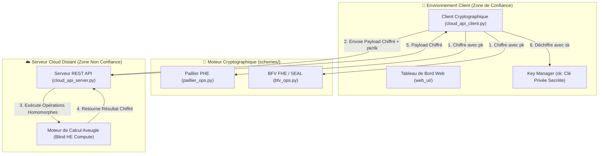

# 🔐 HE_Proto : Prototype de Chiffrement Homomorphe Appliqué à la Banque & au Mobile Money

[](https://www.python.org/)
[](https://opensource.org/licenses/MIT)
[](https://www.docker.com/)
[-critical.svg)](https://homomorphicencryption.org/)

**HE_Proto** est un démonstrateur et framework d'ingénierie logicielle pour l'externalisation sécurisée de calculs bancaires et financiers dans le Cloud (*Blind Cloud Computing* / *Zero-Knowledge Cloud*). 

Grâce aux technologies de **Chiffrement Homomorphe (PHE & FHE)**, les serveurs Cloud exécutent des opérations arithmétiques complexes (sommes de soldes, prélèvements d'agios, calculs de scores de solvabilité, détection de fraude) directement sur des données chiffrées, **sans jamais avoir accès à la clé privée ni aux données financières en clair**.

---

## 📑 Sommaire

1. [✨ Fonctionnalités Clés](#-fonctionnalités-clés)
2. [🏗️ Schémas Cryptographiques & Architecture](#️-schémas-cryptographiques--architecture)
3. [📂 Structure du Dépôt](#-structure-du-dépôt)
4. [🚀 Installation Rapide (Local)](#-installation-rapide-local)
5. [🖥️ Lancement du Serveur & Tableau de Bord Web](#️-lancement-du-serveur--tableau-de-bord-web)
6. [📊 Exécution des Benchmarks & Scénarios Métiers](#-exécution-des-benchmarks--scénarios-métiers)
7. [🐳 Déploiement Conteneurisé & Cloud (Docker / AWS)](#-déploiement-conteneurisé--cloud-docker--aws)
8. [📚 Documentation & Guides Détaillés](#-documentation--guides-détaillés)

---

## ✨ Fonctionnalités Clés

* **Zéro Divulgation (Zero-Knowledge Cloud)** : La clé privée ($sk$) reste strictement cantonnée au client/banque (Zone de Confiance). Le Cloud ne reçoit que des chiffrés et des clés d'évaluation publiques ($pk$, $rlk$).
* **Support Bimodal PHE & FHE** :
  * **Paillier (PHE - 2048/3072 bits)** : Ultra-performant pour les additions homomorphes et multiplications par un scalaire clair (ex: sommes de soldes, application de taux d'agios fixes).
  * **BFV (FHE - Pyfhel / Microsoft SEAL)** : Support complet des additions et multiplications chiffré-par-chiffré avec batching vectoriel (SIMD) et gestion automatique du bruit (*noise budget*).
* **Cas d'Usage Métiers Mobile Money & Banque Africaine (FCFA)** :
  * Prélèvement et calcul automatisé d'agios trimestriels.
  * Calcul de score de solvabilité et éligibilité au micro-crédit Mobile Money.
  * Détection de fraude et de dépassement de plafonds sans révéler l'historique de compte.
* **Serveur Cloud REST API & Dashboard Web** :
  * API HTTP native pour soumission et calcul de payloads chiffrés.
  * Interface Web corporate moderne pour visualiser les métriques, latences et calculs en temps réel.
* **Suite de Benchmarks & Analyse de Sécurité** :
  * Mesure comparative des temps CPU, mémoire, latence réseau et taux d'expansion des chiffrés.
  * Comparateur formel de sécurité aligné sur le standard international *HomomorphicEncryption.org* et les recommandations NIST (128 bits post-quantique).

---

## 🏗️ Schémas Cryptographiques & Architecture



---

## 📂 Structure du Dépôt

```text
HE_Proto/
├── config.py                       # Configuration centrale (tailles de clés, seuils FCFA, réseau)
├── Dockerfile                      # Image Docker serveur basée sur Python 3.11-slim
├── docker-compose.yml              # Configuration d'orchestration Docker
├── requirements.txt                # Dépendances Python (phe, Pyfhel, numpy, pandas, etc.)
├── README.md                       # Présentation générale du projet
├── GUIDE_INGENIEUR_ET_ARCHITECTURE.md # Guide exhaustif d'architecture & workflow ingénieur
├── DEPLOYMENT.md                  # Guide pas-à-pas de déploiement (Local, Docker & AWS EC2)
│
├── schemes/                        # Wrappers cryptographiques homomorphes
│   ├── paillier_ops.py             # Schéma Paillier PHE (2048/3072 bits)
│   └── bfv_ops.py                  # Schéma BFV FHE (Pyfhel / SEAL, gestion du bruit)
│
├── cloud_sim/                      # Infrastructure API et Serveur Cloud
│   ├── cloud_api_server.py         # Serveur REST HTTP natif et hébergement de l'UI
│   ├── cloud_api_client.py         # Client HTTP pour l'envoi et la réception de chiffrés
│   └── local_server.py             # Moteur de simulation en mémoire locale
│
├── benchmarks/                     # Bancs de mesure scientifique & validation
│   ├── baseline_clair.py           # Mesures de référence sur données en clair
│   ├── run_benchmarks.py           # Benchmark de performance CPU / RAM / Payload
│   ├── run_benchmarks_cloud.py     # Benchmark en conditions réelles avec latence réseau HTTP
│   ├── demonstrer_limites.py       # Démonstration des limites (bruit BFV, non-mult Paillier)
│   ├── scenarios_financiers_reels.py # Scénarios Micro-Crédit Mobile Money & Agios
│   └── comparer_securite_parametres.py # Audit et comparaison de sécurité (128 bits standard)
│
├── data/                           # Données synthétiques bancaires (FCFA)
│   └── generer_donnees_realistes.py
│
└── web_ui/                         # Tableau de bord interactif Corporate
    ├── index.html                  # Interface utilisateur Web
    ├── style.css                   # Design system corporate bancaire
    └── app.js                      # Logique interactive et démonstrateur
```

---

## 🚀 Installation Rapide (Local)

### 1. Prérequis
* **Python 3.11** (recommandé pour la compatibilité avec les roues binaires `Pyfhel` / Microsoft SEAL C++).
* **Compilateurs C++ & CMake** (MSVC Build Tools sous Windows, GCC/Clang sous Linux/macOS).
* **Git**.

### 2. Cloner et configurer l'environnement

```bash
# Cloner le dépôt
git clone https://github.com/letsar04/homomorphe-encryption.git
cd homomorphe-encryption

# Créer l'environnement virtuel Python
python -m venv venv

# Activer l'environnement virtuel :
# Windows (PowerShell) :
.\venv\Scripts\Activate.ps1
# Linux / macOS :
source venv/bin/activate

# Installer les dépendances
pip install --upgrade pip setuptools wheel
pip install -r requirements.txt
```

---

## 🖥️ Lancement du Serveur & Tableau de Bord Web

Pour démarrer le serveur API Cloud et l'interface Web :

```bash
python cloud_sim/cloud_api_server.py
```

* **Serveur API REST** : `http://localhost:8000`
* **Tableau de Bord Web** : Ouvrez votre navigateur sur `http://localhost:8000` (ou ouvrez directement `web_ui/index.html`).

---

## 📊 Exécution des Benchmarks & Scénarios Métiers

Toutes les commandes s'exécutent depuis la racine du projet avec l'environnement virtuel activé :

### 1. Scénarios Financiers Réels (Mobile Money & Agios FCFA)
```bash
python benchmarks/scenarios_financiers_reels.py
```

### 2. Benchmark de Performance (CPU, RAM, Expansion Chiffrée)
```bash
python benchmarks/run_benchmarks.py
```

### 3. Benchmark avec Transport Réseau Cloud (HTTP)
*(Assurez-vous que `python cloud_sim/cloud_api_server.py` est lancé dans un terminal séparé)*
```bash
python benchmarks/run_benchmarks_cloud.py
```

### 4. Démonstration Pédagogique des Limites Cryptographiques
```bash
python benchmarks/demonstrer_limites.py
```

### 5. Audit et Comparatif de Sécurité (NIST / HE Standard)
```bash
python benchmarks/comparer_securite_parametres.py
```

---

## 🐳 Déploiement Conteneurisé & Cloud (Docker / AWS)

### Déploiement Local avec Docker

```bash
# Construire et lancer le conteneur
docker compose up --build -d

# Consulter les logs
docker compose logs -f

# Arrêter le conteneur
docker compose down
```

Le serveur sera accessible sur `http://localhost:8000`.

### Déploiement sur AWS EC2

Pour un déploiement pas-à-pas en production sur une instance AWS EC2 (Ubuntu 24.04 LTS, configuration des Security Groups, Docker, et IP publique), consultez le guide dédié :  
👉 **[DEPLOYMENT.md](DEPLOYMENT.md)**

---

## 📚 Documentation & Guides Détaillés

* 📘 **[GUIDE_INGENIEUR_ET_ARCHITECTURE.md](GUIDE_INGENIEUR_ET_ARCHITECTURE.md)** : Référence complète d'architecture logicielle, flux de données, modèles de menaces (*Threat Model*), règles d'or cryptographiques et workflow de contribution.
* 🐳 **[PROCEDURE_DOCKER_UBUNTU.md](PROCEDURE_DOCKER_UBUNTU.md)** : Guide rapide de déploiement Docker sur machine virtuelle Ubuntu.
* 🚀 **[DEPLOYMENT.md](DEPLOYMENT.md)** : Manuel complet d'installation et de déploiement (Local, Docker, AWS EC2).

---

## 🛡️ Licence

Ce projet est distribué sous licence MIT. Consultez le fichier `LICENSE` pour plus de détails.
